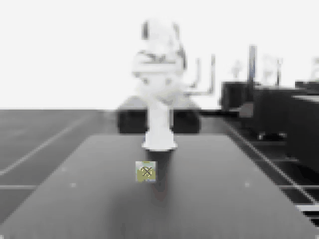
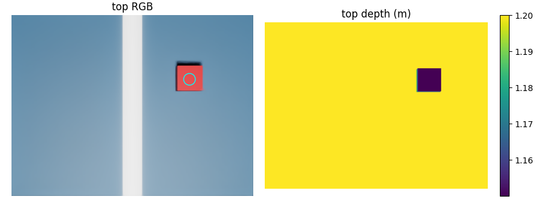
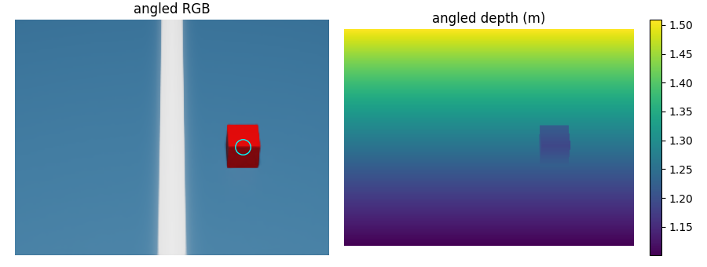
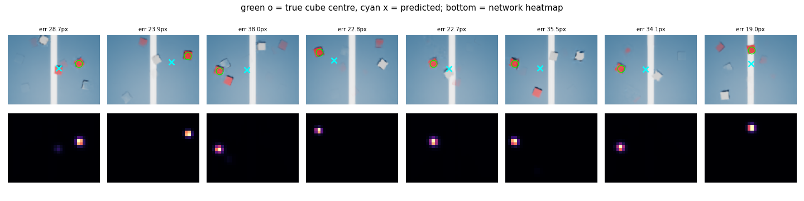
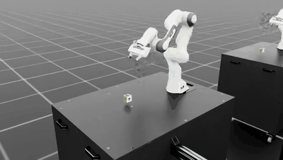
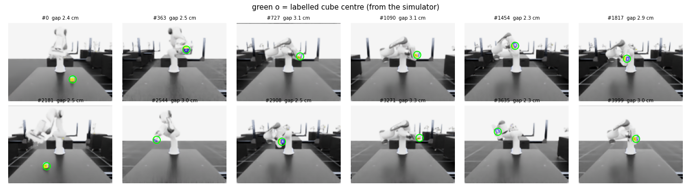

# Robot Arm Learning with Isaac Sim & Isaac Lab

### From "drop a cube" to a robot arm that picks up a cube, carries it, and drops it into a box — trained with reinforcement learning, and driven by a camera


*A policy trained in this course: pick up the cube, carry it over the box, let go. 100 % success over
192 test episodes. Trained from scratch in ~37 minutes on a single RTX 3080.*

This is a hands-on, step-by-step course. Every lesson has runnable code, an explanation of the
concepts, the **real results we measured**, and — just as important — **the things that went wrong
and how we found and fixed them**. RL tutorials usually show only the run that worked. Here you'll
see the four runs it took to get the one above, and why each one failed.

---

## Contents

- [What you'll build](#what-youll-build)
- [Who this is for](#who-this-is-for)
- [The lessons](#the-lessons)
- [Setup (Windows)](#setup-windows) — the hardest part; read the pitfalls
- [How to run things](#how-to-run-things)
- [Lesson-by-lesson walkthrough](#lesson-by-lesson-walkthrough)
- [Pitfalls & lessons learned](#pitfalls--lessons-learned) — every problem we hit, with the fix
- [Pretrained models included](#pretrained-models-included)
- [Repository layout](#repository-layout)
- [What's next](#whats-next)
- [Credits & licences](#credits--licences)

---

## What you'll build

| Stage | What the robot does | Result we measured |
|---|---|---|
| Scripted control | a 6-joint UR10 picks and places a cube with hand-written phases | landed **0.0 cm** from the target |
| Reinforcement learning | a Franka arm *learns* to lift a cube and carry it to a point in the air | cube lifted **~89 %** of each episode, **~10 cm** from the goal after 25 min of training |
| Computer vision | a small CNN finds the cube in camera images | **0.23 px** / **3 mm** error |
| Camera-driven control | the RL policy runs on the camera's estimate instead of the simulator's exact position | **99.7 %** lifted (vs 100 % with exact positions) |
| Reward design | the arm learns pick → carry → **drop into a box** → let go | **100 %** success |

<table>
<tr>
<td></td>
<td></td>
</tr>
<tr>
<td align="center"><b>Learned lifting</b> (lesson 03)</td>
<td align="center"><b>What the camera sees</b> — green ring: true cube centre, red cross: network estimate (lesson 06)</td>
</tr>
</table>

---

## Who this is for

- You know some **Python** and have heard of neural networks.
- You've **never** used Isaac Sim, Isaac Lab or reinforcement learning — that's fine, lesson 01 starts
  from an empty scene.
- You have a Windows PC with an **NVIDIA RTX GPU**. (Everything here was built and verified on Windows
  11, RTX 3080 10 GB, Ryzen 5 5600X, 16 GB RAM. Isaac Sim officially wants 32 GB RAM; 16 GB works with
  care — see the tips.)

Each lesson is a folder with a `lesson.md` (the explanation) and the scripts. Read the `lesson.md`
next to the code — the README gives the overview, the lessons give the depth.

---

## The lessons

| # | Lesson | You learn | Result |
|---|---|---|---|
| 01 | [Hello Isaac](lesson_01_hello_isaac/lesson.md) | the skeleton of every simulation script: app → world → objects → physics steps | cube falls and rests at z = 0.1 m ✅ |
| 02 | [UR10 pick & place](lesson_02_ur10_pick_place/lesson.md) | robot arms, joints, DOF, grippers, inverse kinematics, a scripted state machine | 0.0 cm from target ✅ |
| 03 | [Training intro](lesson_03_training_intro/lesson.md) | reinforcement learning, PPO, rewards, reading training logs, curricula, parallel environments | lifts + carries to goal ✅ |
| 04 | [Cameras](lesson_04_cameras/lesson.md) | RGB + depth cameras, intrinsics/extrinsics, projecting 3D ↔ pixels | 3D from pixel + depth within 2.5 cm ✅ |
| 05 | [Find the cube from the camera](lesson_05_find_cube/lesson.md) | supervised learning on simulated data, heatmap CNN, label checking | 0.23 px / 3 mm ✅ |
| 06 | [Camera-based lift](lesson_06_camera_lift/lesson.md) | teacher → student, distribution shift, camera placement, calibration | 99.7 % lifted from camera ✅ |
| 07 | [Pick and drop](lesson_07_pick_drop/lesson.md) | **reward design**: stage ordering, reward gradients, loopholes, debugging failed runs | 100 % dropped in the box ✅ |
| 08 | [6-joint arm](lesson_08_six_joint_arm/lesson.md) | moving a task to a new robot | ⏸ planned / in progress |

**Why does the camera come after the training?** Learning *where the cube is* (vision) and *how to
move* (control) at the same time from raw pixels needs far more compute than one gaming GPU. The
standard approach — and the one used here — is to first train a **teacher** policy with the exact
cube position from the simulator (lesson 03), then teach a camera to provide that position
(lessons 05–06): the **student**.

---

## Setup (Windows)

> **Read this whole section before installing.** Most of the time in this project went into setup
> problems. Every one we hit is listed here with its fix, so you can skip them.

### Versions that work together

| Component | Version | Notes |
|---|---|---|
| NVIDIA driver | **580.88** | ⚠️ newer drivers (we had 610.88) **crashed Isaac Sim's renderer** — see pitfalls. Isaac Sim 5.1 was tested on 580.88. |
| Isaac Sim | **5.1.0** standalone (zip) | the simulator |
| Isaac Lab | **v2.3.0** (git clone) | the RL framework on top of Isaac Sim |
| Python | **3.11** | Isaac Sim 5.x requires 3.11 |
| PyTorch | **2.7.0 + CUDA 12.8** | must match what Isaac Sim bundles |
| tensordict | **0.8.3** (< 0.9) | ⚠️ newer versions pull in a CPU-only PyTorch |

### 1. NVIDIA driver

Install driver **580.88** (Game Ready, from nvidia.com → "Search all drivers"). If the installer
refuses because "a newer version is present", remove the newer package from the driver store first
(Admin PowerShell: `pnputil /enum-drivers`, find the NVIDIA display driver, then
`pnputil /delete-driver oemNN.inf /uninstall /force`), reboot, install, reboot. Turn off automatic
driver updates (NVIDIA App / Windows Update) afterwards.

### 2. Isaac Sim 5.1 (standalone)

1. Download `isaac-sim-standalone-5.1.0-windows-x86_64.zip` from NVIDIA.
2. Extract it to a folder **without spaces** if you can, e.g. `D:\isaacsim`. Use `tar` — Windows
   Explorer's extractor silently skipped ~11 000 of the 76 000 files for us:
   ```bat
   mkdir D:\isaacsim
   tar -xf isaac-sim-standalone-5.1.0-windows-x86_64.zip -C D:\isaacsim
   ```
   (`tar` skips one file with a Unicode name — a test asset, harmless.)
3. Run `D:\isaacsim\post_install.bat` once.
4. Launch it once to accept the EULA and build the shader cache (first launch: 5–15 min):
   ```bat
   D:\isaacsim\isaac-sim.bat --/isaac/startup/ros_bridge_extension=""
   ```
   The `ros_bridge_extension=""` part disables the ROS 2 bridge, which **hung at startup** for us
   without ROS installed.

### 3. Python environment (conda, Python 3.11)

```bat
conda create -y -p D:\robotics\isaac_lab_5 python=3.11
conda activate D:\robotics\isaac_lab_5
python -m pip install --upgrade pip "setuptools<81" wheel
python -m pip install torch==2.7.0 torchvision==0.22.0 --index-url https://download.pytorch.org/whl/cu128
```

Then tell the env where Isaac Sim is, so `import isaacsim` works whenever it's activated. Create
`D:\robotics\isaac_lab_5\etc\conda\activate.d\env_vars.bat` (adjust the path):

```bat
@echo off
set "RESOURCE_NAME=IsaacSim"
set "CARB_APP_PATH=D:\isaacsim\kit"
set "EXP_PATH=D:\isaacsim\apps"
set "ISAAC_PATH=D:\isaacsim"
set "PYTHONPATH=%PYTHONPATH%;D:\isaacsim\site"
```

(For PowerShell, the same as `env_vars.ps1` with `$env:NAME="value"` lines.) This is what Isaac
Lab's own `isaaclab.bat --conda` would do for a standalone Isaac Sim.

### 4. Isaac Lab v2.3.0

```bat
git clone --depth 1 --branch v2.3.0 https://github.com/isaac-sim/IsaacLab.git D:\robotics\IsaacLab
mklink /J D:\robotics\IsaacLab\_isaac_sim D:\isaacsim
```

Install its packages with **quoted paths** and **without build isolation**. (Isaac Lab's
`isaaclab.bat --install` silently fails if any path contains a space, and build isolation tries to
re-download build tools.)

```bat
set "ISAACLAB=D:\robotics\IsaacLab"
python -m pip install flatdict==4.0.1 --no-build-isolation
for %m in (isaaclab isaaclab_assets isaaclab_tasks isaaclab_rl) do python -m pip install --no-build-isolation -e "%ISAACLAB%\source\%m"
python -m pip install --no-build-isolation -e "%ISAACLAB%\source\isaaclab_rl[rsl_rl]"
```

**Then fix the two dependency traps** (both happened to us):

```bat
rem 1. a newer tensordict demands torch >= 2.11 and drags in a CPU-only torch -> pin it
python -m pip install "tensordict>=0.7,<0.9" --no-deps
python -m pip install orjson importlib_metadata
rem 2. make sure torch is still the CUDA build
python -m pip install torch==2.7.0 torchvision==0.22.0 --index-url https://download.pytorch.org/whl/cu128
python -c "import torch; print(torch.__version__, torch.cuda.is_available())"
```

The last line must print `2.7.0+cu128 True`.

### 5. Point this repo at your install

`run.bat` reads two environment variables (set them once, then open a new terminal):

```bat
setx ISAAC_ENV  "D:\robotics\isaac_lab_5"
setx CONDA_ROOT "%USERPROFILE%\anaconda3"
```

The lesson pages use these placeholders in commands — replace them or set them as variables too:

| Placeholder | Meaning | Example |
|---|---|---|
| `%ISAACLAB%` | your Isaac Lab clone | `setx ISAACLAB "D:\robotics\IsaacLab"` |
| `%ISAACSIM%` | your Isaac Sim folder | `setx ISAACSIM "D:\isaacsim"` |
| `<repo>` | this repository's folder | — |

### 6. Windows settings that block Isaac Sim

- **Controlled Folder Access** (Windows Security → Ransomware protection) blocks Isaac Sim from writing
  its settings to `Documents\Kit`. Either allow `D:\isaacsim\kit\kit.exe` and
  `D:\robotics\isaac_lab_5\python.exe`, or turn the feature off.
- If `cmd`, `findstr` or `nvidia-smi` are "not recognized", your `PATH` is missing
  `C:\Windows\System32` — add it back.

### 7. Check it works

```bat
cd <repo>
run.bat lesson_01_hello_isaac\hello_isaac.py --headless
```

Expected final line: `DONE - cube landed at z = 0.1`.

---

## How to run things

Everything is run from the repository folder, in **cmd** (or PowerShell with `.\run.bat`):

| Script type | Command |
|---|---|
| lesson scripts (Isaac Sim / our own Isaac Lab scripts) | `run.bat lesson_XX_...\script.py [args]` |
| Isaac Lab's `train.py` | `run.bat "%ISAACLAB%\scripts\reinforcement_learning\rsl_rl\train.py" --task ... --headless` |
| Isaac Lab's `play.py` (opens a window) | `run.bat isaaclab_run.py "%ISAACLAB%\scripts\reinforcement_learning\rsl_rl\play.py" --task ...` |
| lesson 07's custom tasks | `run.bat lesson_07_pick_drop\run_task.py "%ISAACLAB%\scripts\...\train.py" --task Lesson-DropInBox-Franka-v0 ...` |

- **`run.bat`** activates the env (only if it isn't already — activating twice overflows `PATH`),
  accepts the Isaac Sim EULA for that run, and runs Python unbuffered so `print` shows up.
- **`isaaclab_run.py`** works around a DLL clash: Isaac Sim's RTX-sensor extension ships its own
  `hdf5.dll`; in window mode it loads first and Isaac Lab's `import h5py` crashes. The wrapper imports
  `h5py` first.
- **`--headless`** = no window. Faster, less memory, and the right choice for training.

**Memory tips for 16 GB RAM:** close the Isaac Sim window before running a script, close browsers /
Discord / Teams while training, and stop background database services if you have them.

---

## Lesson-by-lesson walkthrough

### 01 — Hello Isaac

The smallest useful script: start the simulator, add a ground plane and a cube, step the physics,
read the cube's position. The cube falls from 1 m and rests at **z = 0.1 m** — its centre, half of
its 0.2 m size. Every later script follows the same loop: *read state → decide → act → step*.
→ [lesson](lesson_01_hello_isaac/lesson.md) · [`hello_isaac.py`](lesson_01_hello_isaac/hello_isaac.py)

### 02 — UR10 pick & place (scripted)

A real 6-joint industrial arm (UR10) with a suction gripper picks up a cube and places it at a
target using a **state machine** of 10 phases (move above → lower → grip → lift → carry → lower →
release → …). A motion planner (RMPflow) does the **inverse kinematics**: "hand should be *here*" →
"joints should be at *these angles*". Result: **0.0 cm** from the target. Perfect — but only because
a human wrote every phase and the cube's exact position is known.
→ [lesson](lesson_02_ur10_pick_place/lesson.md) · [`ur10_pick_place.py`](lesson_02_ur10_pick_place/ur10_pick_place.py)

### 03 — Training intro: teach an arm to lift

Isaac Lab's `Isaac-Lift-Cube-Franka-v0` task, trained with **PPO**. The arm observes joint angles,
the cube position and a goal point, and is rewarded in stages: reach the cube → lift it → carry it
to the goal. You learn to read every line of the training log
([reference](lesson_03_training_intro/reading_training_output.md)) and how the learning works
([deep dive](lesson_03_training_intro/how_it_learns.md)).

This lesson contains **two real failures**, and they're the most valuable part:

<table>
<tr>
<td width="50%"></td>
<td width="50%"></td>
</tr>
<tr>
<td align="center">256 parallel arms: they learn to <b>reach</b>, but never discover <b>lifting</b> in 4500 iterations</td>
<td align="center">4096 parallel arms: lifting discovered at iteration ~200, carries the cube to the goal</td>
</tr>
</table>

1. **A curriculum tuned for a big GPU broke a small run.** The task makes its smoothness penalties
   1000× stronger after 10 000 steps (~iteration 417). With 4096 arms the policy can already lift by
   then; with 64 arms it can't, and a huge penalty on movement teaches it to **stay still** (reward
   went negative).
2. **"More arms" was worth trying.** We assumed a 10 GB GPU needed few arms. Measured: 256, 1024, 2048
   and 4096 arms all take **~0.9 s per iteration**. 4096 gives 16× more experience for free — and
   lifting appeared at iteration ~200 instead of never.

Final result (4096 arms, 25 min): lifting reward 13.4 / 15, goal tracking 12.9 / 16, cube ~10 cm from
the goal, drops 0.02 %. → [lesson](lesson_03_training_intro/lesson.md)

### 04 — Cameras

Add an RGB and a depth camera, then learn the two conversions every vision robot uses:
**3D point → pixel** (projection, with the camera's intrinsics *K* and pose) and **pixel + depth → 3D**
(back-projection). Recovered position error: **2.5 cm** — exactly half the cube, because depth sees the
cube's *top face*, not its centre.

 

*Left: top camera, right: angled camera. Cyan circle = where projection says the cube centre is.*
→ [lesson](lesson_04_cameras/lesson.md) · [`cameras.py`](lesson_04_cameras/cameras.py)

### 05 — Find the cube from the camera

Generate 3000 labelled images in simulation (labels are free and exact!), with a grey decoy cube, and
train a small **heatmap CNN** (soft-argmax) to find the red cube. Result on unseen images:
**0.23 px** pixel error, **3 mm** 3D error with the "cube rests on the table" prior.



The first attempt **didn't learn at all** (loss flat for 40 epochs). Drawing the labels on the images
showed why: every image showed the cube where the *previous* sample had put it — the renderer lags a
few frames. Measured: image *i* matched label *i − 1* to 1.19 px. Fix: render until an independent
check (centre of the red pixels) agrees with the label. **Always look at your data before training.**
→ [lesson](lesson_05_find_cube/lesson.md)

### 06 — Camera-driven lifting (teacher → student)

Add a front camera to every arm in the lift scene, collect 4000 labelled images **from that scene**
(the lesson-05 detector had never seen a yellow cube, a table or a robot — distribution shift),
retrain, and swap the policy's "cube position" input for the camera's estimate. The policy itself is
unchanged.

| same policy, 64 arms × 3 episodes | exact position | camera |
|---|---|---|
| cube lifted (% of time) | 100.0 % | **99.7 %** |
| cube–goal distance | 1.6 cm | **2.1 cm** |
| camera estimate error | 0.75 cm | 1.04 cm |

<table>
<tr>
<td width="50%"></td>
<td width="50%"></td>
</tr>
<tr>
<td align="center">the arm, driven by the camera estimate</td>
<td align="center">what the camera sees: green = truth, red = estimate</td>
</tr>
</table>



The camera is placed in front of the table looking back at the robot — from above, the gripper hides
the cube exactly when it grasps it. Full videos:
[overview, exact](lesson_06_camera_lift/output/videos/overview_exact.mp4) ·
[overview, camera](lesson_06_camera_lift/output/videos/overview_camera.mp4) ·
[camera view, exact](lesson_06_camera_lift/output/videos/camera_exact.mp4) ·
[camera view, camera](lesson_06_camera_lift/output/videos/camera_camera.mp4)
→ [lesson](lesson_06_camera_lift/lesson.md)

### 07 — Pick and drop: designing a reward

Same robot and training setup; the only new thing is the **reward**. This lesson is a case study in
reward design — it took four runs:

| Version | Idea | What happened |
|---|---|---|
| lift policy (lesson 03) | — | carries the cube to the target and hovers: "let go" was never rewarded |
| **v1** | place on a spot on the table | held the cube perfectly above the spot (0.2 cm) — **at 71 cm height** — and never put it down |
| **v2a** | drop into a box, lift weight 5 | never learned to lift before the penalty curriculum kicked in → "don't move"; plus a PhysX buffer overflow silently dropping collisions |
| **v2b** | lift weight 15, box rewards 25 + 25, curriculum delayed, bigger PhysX buffer | **100 % in the box and released** |

<table>
<tr>
<td width="50%"></td>
<td width="50%"></td>
</tr>
<tr>
<td align="center"><b>v1</b>: the carry reward ignored height, so nothing pulled the cube down</td>
<td align="center"><b>v2b</b>: pick → carry → drop into the box → let go</td>
</tr>
</table>

Principles you'll take away:

- **Every stage must pay more than the one before** (hovering 27/s < dropped and released 50/s), or
  the policy stops at the earlier stage.
- **A reward needs a *gradient* toward the goal**, not only a payout at the goal. v1's carry reward
  paid the same at 71 cm and 3 cm.
- **Close loopholes**: "placed" only counts if the cube was *carried* (otherwise: push it there).
  And test that check against cases where it must *not* fire — ours fired every episode at first,
  because the cube spawns 5.5 cm up and drops.
- **Read the warnings at the start of every run.** PhysX told us it would "miss interactions".

Full videos: [v2b success](lesson_07_pick_drop/output/videos/box_2026-10-24_21-09-44.mp4) ·
[v1 hovering](lesson_07_pick_drop/output/videos/pick_drop_2026-10-24_19-59-40.mp4) ·
[lift policy in the box task](lesson_07_pick_drop/output/videos/box_2026-10-24_17-36-25.mp4) ·
[lift policy in the spot task](lesson_07_pick_drop/output/videos/pick_drop_2026-10-24_17-36-25.mp4)
→ [lesson](lesson_07_pick_drop/lesson.md)

### 08 — A 6-joint arm (planned)

The plan for moving pick-and-drop to a 6-joint arm (Kinova Jaco2 first, UR10e + Robotiq next): why a
new robot needs new training, what changes in the config, and what can go wrong.
→ [lesson](lesson_08_six_joint_arm/lesson.md)

---

## Pitfalls & lessons learned

Every problem we hit, in one place. If something breaks for you, start here.

| Symptom | Cause | Fix |
|---|---|---|
| Isaac Sim crashes when the 3D viewport appears (also headless), crash in `rtx.scenedb.plugin.dll` | NVIDIA driver too new (610.88) for Isaac Sim 5.1's renderer | install driver **580.88** |
| Isaac Sim hangs at ~75 s after `rclpy loaded` | ROS 2 bridge extension | launch with `--/isaac/startup/ros_bridge_extension=""` |
| "Unauthorized changes blocked … kit.exe / python.exe" | Windows Controlled Folder Access | allow both executables or disable the feature |
| Isaac Sim files missing after extracting the zip | Explorer's zip extractor skipped files | extract with `tar -xf` |
| `torch.cuda.is_available()` is `False` after installing Isaac Lab | a dependency pulled a CPU-only torch from PyPI | reinstall `torch==2.7.0` from the cu128 index; pin `tensordict<0.9` |
| `cannot import name 'is_structseq_instance'` | tensordict too new for torch 2.7 | `pip install "tensordict>=0.7,<0.9" --no-deps` |
| `isaaclab.bat --install` "succeeds" but nothing is installed | it doesn't quote paths with spaces | pip install each package yourself (see setup) |
| `DLL load failed while importing _errors` (h5py) in window mode | Isaac Sim's RTX-sensor `hdf5.dll` clashes with h5py's | run via `isaaclab_run.py` (pre-imports h5py) |
| `The input line is too long` | conda env activated twice in the same terminal | `run.bat` only activates when needed; open a fresh terminal |
| camera returns no image for the first frames | renderer warm-up / shader compilation | wait until `get_rgb()` returns data |
| images show the object where it *was* | renderer lag / temporal accumulation ("ghosts") | render more frames after moving things; verify labels against the image |
| reward goes negative, arm stops moving (~iteration 400) | curriculum penalty switched on before the skill was learned | more parallel envs, or delay the curriculum (`env.curriculum.*.params.num_steps=...`) |
| arm reaches but never lifts | too little experience per iteration (few envs) — local optimum | use 4096 envs (measure — it may cost no extra time) |
| arm holds the object above the target forever | the reward has no gradient toward the final state | reward the remaining distance in 3D, make each stage pay more |
| `PhysX error: … increase totalAggregatePairsCapacity` | extra colliders × 4096 envs overflow a GPU buffer | raise `sim.physx.gpu_total_aggregate_pairs_capacity` |
| `The term 'X' is not callable` in a reward config | function and reward term share a name inside the config class | give functions a different name (e.g. `x_reward`) |

---

## Pretrained models included

So you can run evaluations and videos without training first:

| Model | Path | Used by |
|---|---|---|
| Franka lift policy (lesson 03) | `logs/rsl_rl/franka_lift/2026-10-24_17-36-25/model_1499.pt` | lessons 03, 06, 07 baseline |
| Franka drop-in-box policy (lesson 07 v2b) | `logs/rsl_rl/franka_drop_in_box/2026-10-24_21-09-44/model_1999.pt` | lesson 07 |
| Cube detector, plain floor (lesson 05) | `lesson_05_find_cube/models/cube_detector.pt` | lesson 05 |
| Cube detector, lift scene (lesson 06) | `lesson_06_camera_lift/models/lift_cube_detector.pt` | lesson 06 |

Each policy folder also has `params/` (the exact environment and PPO settings used) and `exported/`
(the policy as TorchScript and ONNX). Datasets and intermediate checkpoints are not included — the
lesson scripts regenerate them.

---

## Repository layout

```
.
├── README.md                     this file
├── run.bat                       run any lesson script inside the env
├── isaaclab_run.py               run Isaac Lab scripts with the h5py DLL workaround
├── media/                        GIF previews used in this README
├── lesson_01_hello_isaac/        lesson.md + script
├── lesson_02_ur10_pick_place/
├── lesson_03_training_intro/     lesson.md, how_it_learns.md, reading_training_output.md
├── lesson_04_cameras/            cameras.py, output/ (images)
├── lesson_05_find_cube/          generate_data.py, cube_finder.py, train_detector.py, models/, output/
├── lesson_06_camera_lift/        camera_lift.py, collect_data.py, train_detector.py, evaluate.py, models/, output/
├── lesson_07_pick_drop/          pick_drop_env_cfg.py (tasks + rewards), run_task.py, evaluate.py, output/videos/
├── lesson_08_six_joint_arm/      plan + inspect_arms.py
└── logs/rsl_rl/                  trained policies (final checkpoints only)
```

---

## What's next

- **Lesson 08 — 6-joint arm:** pick-and-drop on a Kinova Jaco2 (6 joints, 3 fingers), then a UR10e +
  Robotiq gripper. The training recipe from lesson 07 carries over; the robot config and a new training
  run don't.
- **Lesson 07b — camera-driven drop:** combine lessons 06 and 07 — drop into the box using the camera
  instead of the exact cube position.
- Ideas to try yourself are at the end of every `lesson.md` ("Try it").

---

## Credits & licences

- [**NVIDIA Isaac Sim**](https://developer.nvidia.com/isaac/sim) — the simulator. Use is subject to
  NVIDIA's Omniverse licence (you accept it on first launch).
- [**Isaac Lab**](https://github.com/isaac-sim/IsaacLab) (BSD-3-Clause) — the RL framework; the lift
  task, PPO settings and training scripts used here are Isaac Lab's.
- [**RSL-RL**](https://github.com/leggedrobotics/rsl_rl) — the PPO implementation.
- Lessons 02 and 04 are based on NVIDIA's standalone examples shipped with Isaac Sim (noted at the top
  of each script).
- Robot and object models (Franka, UR10, DexCube, tables) are NVIDIA assets, downloaded by Isaac Sim at
  runtime — they are not part of this repository.

